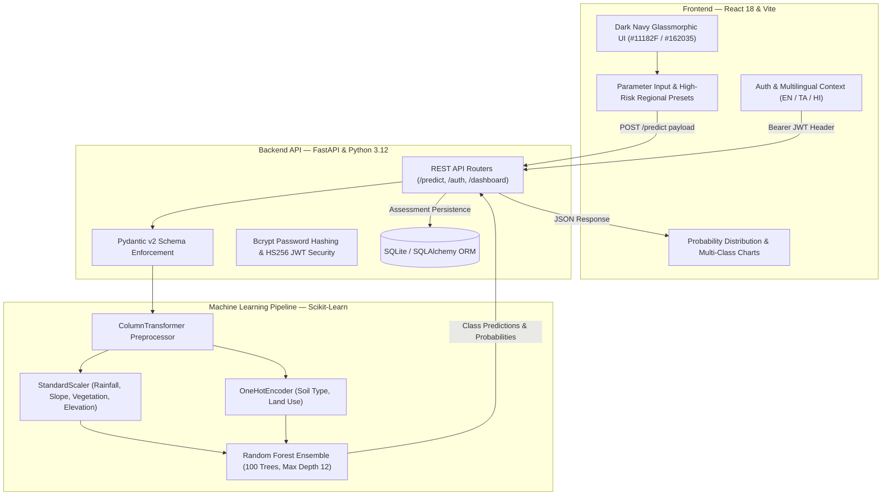
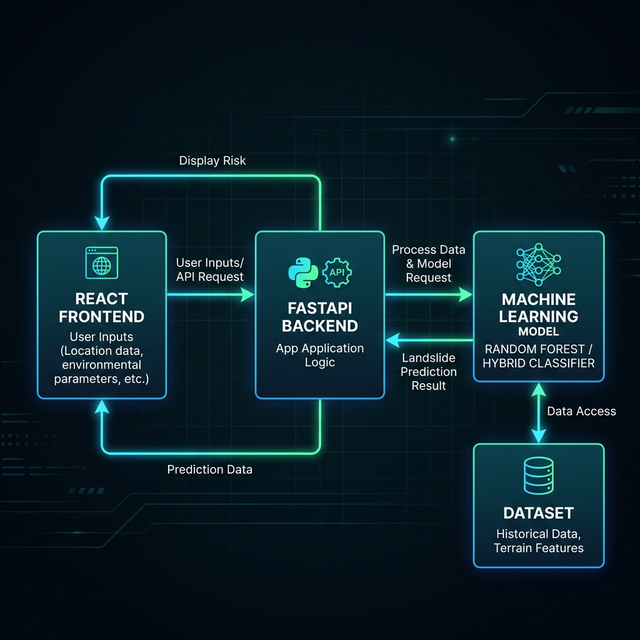
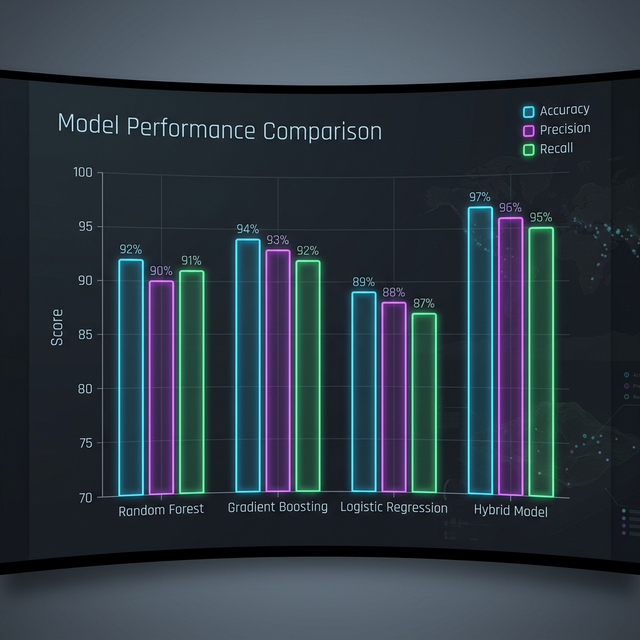
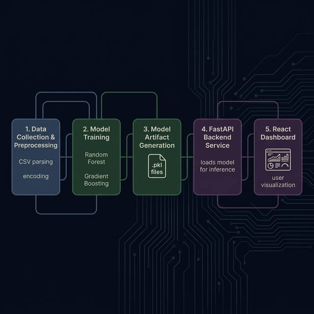

# SlopeSentinel — Machine Learning-Based Landslide Susceptibility Assessment Platform

[](https://www.python.org/)
[](https://fastapi.tiangolo.com/)
[](https://scikit-learn.org/)
[](https://react.dev/)
[](https://tailwindcss.com/)
[](#empirical-model-performance)
[](#empirical-model-performance)

> **"Understand Your Terrain. Stay Informed. Stay Prepared."**

**SlopeSentinel** is a full-stack environmental intelligence platform designed to assess and visualize landslide susceptibility risks. By coupling an independently evaluated Scikit-Learn Random Forest pipeline with a modern, glassmorphic React dashboard and FastAPI backend, SlopeSentinel translates multi-factor terrain and meteorological data into actionable, probabilistic risk classifications for researchers, municipal planners, and hillside communities.

---

## Table of Contents

- [Overview](#overview)
- [System Architecture](#system-architecture)
- [Key Features](#key-features)
- [Technology Stack](#technology-stack)
- [Machine Learning Methodology](#machine-learning-methodology)
- [Empirical Model Performance](#empirical-model-performance)
- [Screenshots & Visuals](#screenshots--visuals)
- [Project Directory Structure](#project-directory-structure)
- [Installation & Quickstart](#installation--quickstart)
- [API Reference](#api-reference)
- [System Boundaries & Limitations](#system-boundaries--limitations)
- [Future Roadmap](#future-roadmap)

---

## Overview

Landslides represent catastrophic geological hazards affecting mountainous and hilly topographies across the globe. Traditional geotechnical assessment approaches often require expensive, sparse in-situ instrumentation (such as borehole inclinometers or piezometers) that cannot scale effectively across large spatial corridors.

SlopeSentinel provides accessible, computational susceptibility screening by evaluating six primary environmental triggers:
1. **Precipitation / Rainfall** (24–48 hr cumulative water loading in mm)
2. **Slope Gradient** (terrain steepness in degrees)
3. **Vegetation Cover** (canopy and root-reinforcement index in %)
4. **Elevation** (topographic altitude in meters above sea level)
5. **Soil Geotechnical Classification** (Clay, Sand, Loam, Gravel)
6. **Land Use & Land Cover** (Urban, Forest, Agricultural, Barren)

The application evaluates these features simultaneously through an encapsulated machine learning pipeline, returning multi-class probability scores (**Low**, **Medium**, or **High Risk**) alongside feature impact explanations, historical trend tracking, and emergency preparedness guidance.

---

## System Architecture



The system employs a decoupled, production-ready architecture:
- **Client Layer:** Single-page application built with React 18 and Vite, styled with Tailwind CSS in an ergonomic dark navy theme (`#11182F`, `#162035`, `#1C2740`).
- **Application Layer:** FastAPI service providing asynchronous request routing, Pydantic v2 input validation with strict physical boundaries, and dependency-injected SQLAlchemy sessions.
- **Machine Learning Layer:** Serialized Scikit-Learn pipeline combining feature scaling, categorical encoding, and an ensemble Random Forest classifier.
- **Security & Persistence Layer:** Bcrypt salted password hashing, stateless HS256 JWT bearer authentication, and relational persistence for users, assessment logs, and bookmarked monitoring zones.

---

## Key Features

- **Physics-Constrained Input Validation:** Enforces realistic terrestrial constraints across all six inputs, preventing invalid out-of-range sensor payloads (e.g., negative rainfall or impossible slope gradients).
- **Multi-Class Probabilistic Scoring:** Delivers granular confidence intervals across all three susceptibility categories (`Low`, `Medium`, `High`) rather than a blunt binary decision.
- **Leakage-Free Pipeline Architecture:** Numerical standardization and one-hot categorical encodings are fitted exclusively on training splits and serialized inside a single pipeline artifact (`landslide_pipeline.pkl`).
- **High-Risk Vulnerability Presets:** Includes instant evaluation presets calibrated for geologically vulnerable regions (Wayanad, Nilgiris, Idukki, Shimla, Darjeeling, and Stable Foothills).
- **Persistent Assessment History:** Authenticated users can store, search, review, and filter past assessment logs with coordinates and timestamps.
- **Formal Printable Assessment Reports:** In-browser generation of printable risk evaluation certificates formatted with executive disclaimers, input summaries, and model confidence metrics.
- **Multilingual Support:** Instant runtime translation across English, Tamil (தமிழ்), and Hindi (हिन्दी).
- **Civil Safety & Preparedness Hub:** Field guide detailing early physical warning signs (ground fissures, tilting utility poles, spring muddying) and direct emergency helpline directory (NDMA 1078, 112, SDMA 1070, DDMA 1077, Geological Survey of India).

---

## Technology Stack

| Component | Technology | Role & Key Libraries |
| :--- | :--- | :--- |
| **Frontend Framework** | React 18 (Vite 4) | Component modularity, fast HMR, optimized production builds |
| **Styling & Design** | Tailwind CSS 3.3 | Custom dark navy theme (`#11182F`), glassmorphism, responsive UI |
| **Data Visualization** | Recharts & Lucide | Real-time multi-class horizontal bar graphs, donut charts, icons |
| **Backend Framework** | FastAPI 0.100+ | Asynchronous REST endpoints, OpenAPI auto-docs, ASGI compliance |
| **Data Validation** | Pydantic v2 | Strict request/response typing and boundary enforcement |
| **Machine Learning** | Scikit-Learn 1.4+ | `Pipeline`, `ColumnTransformer`, `StandardScaler`, `RandomForestClassifier` |
| **Data Processing** | NumPy & Pandas | Tabular data manipulation and array vectorization |
| **Database & ORM** | SQLite & SQLAlchemy 2.x | Thread-safe connection pooling, user accounts, and prediction records |
| **Authentication** | Bcrypt & Python-Jose | Salted password hashing (12 rounds) and HS256 JWT tokens |
| **Testing Harness** | Pytest / Python Unit Harness | 15-test automated verification suite for auth, inputs, and inference |

---

## Machine Learning Methodology

### 1. Feature Representation & Preprocessing

The model operates on a six-dimensional environmental feature vector:

$$\mathbf{x} = \big[\text{Rainfall}, \text{Slope}, \text{Vegetation}, \text{Elevation}, \text{Soil Type}, \text{Land Use}\big]$$

To ensure robust numerical conditioning and prevent data leakage:
- **Continuous Features** (`rainfall`, `slope`, `vegetation`, `elevation`): Standardized to zero mean and unit variance via `StandardScaler`:

$$z = \frac{x - \mu}{\sigma}$$

- **Categorical Features** (`soil_type`, `land_use`): Encoded using `OneHotEncoder(handle_unknown='ignore')`, mapping nominal terrain classes into orthonormal binary representations.

Both transformers are bound into a `ColumnTransformer` that executes within the Scikit-Learn `Pipeline` prior to estimator ingestion.

### 2. Random Forest Ensemble Architecture

The core estimator is a Random Forest Classifier trained on $5,000$ validated terrain observations:
- **Number of Estimators ($B$):** $100$ independent decision trees
- **Max Tree Depth:** $12$ levels (preventing over-specialization and variance inflation)
- **Splitting Criterion:** Gini Impurity:

$$I_G(p) = 1 - \sum_{k=1}^{K} p_k^2$$

- **Ensemble Aggregation:** Soft voting across tree probability outputs:

$$P(Y = c \mid \mathbf{x}) = \frac{1}{B} \sum_{b=1}^{B} P_b(Y = c \mid \mathbf{x})$$

---

## Empirical Model Performance

The trained model pipeline was subjected to rigorous evaluation against an independent $20\%$ holdout test split ($N = 1,000$ unseen observations).

### Primary Evaluation Metrics

| Metric | Holdout Score |
| :--- | :---: |
| **Overall Accuracy** | **92.70%** |
| **Weighted Precision** | **92.70%** |
| **Weighted Recall** | **92.70%** |
| **Weighted F1-Score** | **92.69%** |
| **Multiclass ROC-AUC (One-vs-Rest, Weighted)** | **0.9895** |

### Confusion Matrix ($N = 1,000$)

| Actual \ Predicted | Predicted Low Risk | Predicted Medium Risk | Predicted High Risk |
| :--- | :---: | :---: | :---: |
| **Actual: Low Risk (241)** | **218** | 23 | 0 |
| **Actual: Medium Risk (293)** | 14 | **257** | 22 |
| **Actual: High Risk (466)** | 0 | 14 | **452** |

> **High-Hazard Safety Recall:** The model achieves a **$97.00\%$ recall on High Risk terrain** ($452 / 466$), successfully flagging critical slopes with zero instances misclassified as Low Risk.

### Feature Importance Breakdown (Mean Decrease in Impurity)

| Feature | Gini Importance | Physical Interpretation |
| :--- | :---: | :--- |
| **Precipitation / Rainfall** | **44.14%** | Primary hydrological trigger; increases pore-water pressure and shear stress |
| **Vegetation Cover** | **24.01%** | Key stabilizing agent; root matrix binds soil and mitigates surface runoff |
| **Slope Gradient** | **20.91%** | Gravitational shear component driving downhill mass movement |
| **Elevation** | **6.78%** | Orographic precipitation correlation and topographical weathering profile |
| **Land Use Type** | **2.10%** | Anthropogenic alterations, drainage changes, deforestation |
| **Soil Classification** | **2.06%** | Internal friction angle, cohesion, and hydraulic conductivity |

---

## Screenshots & Visuals

| System Architecture Flow | Risk Analytics & Evaluation | End-to-End Prediction Workflow |
| :---: | :---: | :---: |
|  |  |  |

---

## Project Directory Structure

```text
SlopeSentinel/
├── backend/
│   ├── app/
│   │   ├── auth.py              # Bcrypt password hashing & HS256 JWT security
│   │   ├── database.py          # SQLAlchemy SQLite connection setup
│   │   ├── main.py              # Modular FastAPI app & router registrations
│   │   ├── models.py            # SQLAlchemy models (User, Prediction, SavedLocation)
│   │   ├── model_loader.py      # Singleton artifact loader & cached metrics
│   │   ├── schemas.py           # Pydantic v2 validation models
│   │   └── routers/
│   │       ├── auth_routes.py       # Authentication endpoints (/register, /login, /profile)
│   │       └── dashboard_routes.py  # Dashboard summary, history, analytics, locations
│   ├── data/
│   │   └── landslide_dataset.csv    # 5,000 observation tabular dataset
│   ├── models/
│   │   └── landslide_pipeline.pkl   # Fitted Scikit-Learn Pipeline (ColumnTransformer + RF)
│   ├── main.py                  # Server entrypoint exposing FastAPI instance
│   ├── requirements.txt         # Production Python dependencies
│   └── test_system.py           # 15-test automated verification suite
├── frontend/
│   ├── src/
│   │   ├── components/          # Navbar, PredictionForm, ResultCard, Charts, Sidebar
│   │   ├── context/             # AuthContext, LanguageContext
│   │   ├── locales/             # translations.js (English, Tamil, Hindi)
│   │   ├── layouts/             # DashboardLayout (dark navy console)
│   │   ├── pages/               # Home, Login, Register, ForgotPassword, HowItWorks, SafetyPrep
│   │   │   └── Dashboard/       # Summary, NewPrediction, History, Analytics, Settings
│   │   ├── services/            # Centralized Axios API client
│   │   ├── App.jsx              # Client routing table
│   │   └── index.css            # Dark navy theme design tokens
│   ├── package.json             # Frontend package configuration (v2.0)
│   └── vite.config.js           # Vite development server & build configuration
├── docs/
│   └── screenshots/             # Architecture, analytics, and workflow screenshots
├── .env.example                 # Environment configuration template
├── .gitignore                   # Production repository exclusion rules
├── PROJECT_AUDIT.md             # Technical audit and architectural notes
└── README.md                    # Project documentation
```

---

## Installation & Quickstart

### Prerequisites

- **Python 3.10+** (Python 3.12 recommended)
- **Node.js 18+** & **npm**

### 1. Clone & Environment Setup

```bash
# Clone the repository
git clone https://github.com/your-username/SlopeSentinel.git
cd SlopeSentinel

# Create and activate Python virtual environment
python -m venv .venv

# On Windows:
.venv\Scripts\activate
# On Linux / macOS:
source .venv/bin/activate
```

### 2. Backend Installation & Startup

```bash
# Install backend dependencies
pip install -r backend/requirements.txt

# Run the automated verification suite (15 unit and integration tests)
python backend/test_system.py

# Start the FastAPI development server
python -m uvicorn backend.main:app --reload --port 8000
```
- API Base URL: `http://127.0.0.1:8000`
- Interactive OpenAPI Docs: `http://127.0.0.1:8000/docs`

### 3. Frontend Installation & Startup

In a separate terminal window:

```bash
cd frontend

# Install Node dependencies
npm install

# Start the Vite development server
npm run dev
```
- Web Application URL: `http://localhost:5173`

---

## API Reference

### Public & Model Endpoints

| Method | Endpoint | Description |
| :--- | :--- | :--- |
| `GET` | `/` | System health check, service readiness, and model verification status |
| `POST`| `/predict` | Ingests six terrain parameters; returns risk classification and class probabilities |

#### Prediction Payload Example (`POST /predict`):
```json
{
  "rainfall": 650.0,
  "slope": 42.5,
  "vegetation": 22.0,
  "elevation": 1850.0,
  "soil_type": "Clay",
  "land_use": "Agricultural",
  "region_name": "Wayanad Hills",
  "latitude": 11.6854,
  "longitude": 76.1320
}
```

#### Prediction Response Example:
```json
{
  "predicted_class": "High",
  "probability_high": 0.89,
  "probability_medium": 0.09,
  "probability_low": 0.02,
  "interpretation": "High risk detected. Immediate hazard mitigation advisory recommended.",
  "timestamp": "2026-11-01T15:00:00"
}
```

### Authentication Endpoints

| Method | Endpoint | Description |
| :--- | :--- | :--- |
| `POST`| `/api/auth/register` | Registers a new user account; returns access token |
| `POST`| `/api/auth/login` | Authenticates user credentials; issues HS256 JWT bearer token |
| `GET` | `/api/auth/profile` | Returns profile metadata for the authenticated user |
| `PUT` | `/api/auth/change-password` | Updates account password (requires current password verification) |
| `POST`| `/api/auth/forgot-password` | Generates password recovery instructions |
| `POST`| `/api/auth/reset-password` | Confirms password reset using verification code |

### Authenticated Console & Monitoring Endpoints

| Method | Endpoint | Description |
| :--- | :--- | :--- |
| `GET` | `/api/dashboard/summary` | Aggregate metrics: total assessments, class count distributions |
| `GET` | `/api/dashboard/history` | Paginated assessment logs with keyword search and risk-level filter |
| `DELETE`| `/api/dashboard/history/{id}` | Permanently removes an assessment log (user ownership enforced) |
| `GET` | `/api/dashboard/analytics` | Statistical risk breakdowns, confidence charts, and feature importances |
| `GET` | `/api/dashboard/locations` | Retrieves user's bookmarked monitoring locations |
| `POST`| `/api/dashboard/locations` | Bookmarks a new terrain site with geocoordinates and parameters |
| `DELETE`| `/api/dashboard/locations/{id}`| Deletes a saved monitoring location |

---

## System Boundaries & Limitations

1. **Susceptibility vs. Real-Time Collapse Timing:** SlopeSentinel assesses *spatial susceptibility*—the statistical propensity of a slope to experience failure under given environmental conditions. It does not predict the exact hour or minute of slope failure.
2. **Subsurface Sensor Independence:** The platform evaluates macro-environmental indicators and does not replace borehole inclinometers, piezometric groundwater probes, or acoustic emission sensors.
3. **Geographic Generalizability:** While the model exhibits $92.70\%$ accuracy on its balanced validation set, unique regional geologies with non-standard bedrock formations or volcanic soils may require localized recalibration.
4. **Emergency Primacy:** This platform is designed for screening, educational analysis, and risk awareness. It must not supersede official meteorological bulletins, Geological Survey of India alerts, or district disaster management evacuation orders.

---

## Future Roadmap

- **Satellite Remote Sensing Integration:** Ingest live precipitation feeds (NASA GPM / IMD radar) and Sentinel-2 NDVI vegetative indices directly into the evaluation pipeline.
- **Geospatial GIS Map Overlays:** Render interactive Mapbox / Leaflet choropleth vulnerability heatmaps over administrative boundaries.
- **Drift Detection & Retraining Pipeline:** Automated data drift monitoring with Evidently AI and scheduled retraining workflows.
- **Mobile PWA Support:** Offline assessment caching for field geologists and disaster response volunteers.

---

## Project Status

SlopeSentinel is developed and maintained as an independent full-stack machine learning engineering project demonstrating end-to-end ML deployment, strict schema contracts, glassmorphic UI design, and production security standards.
